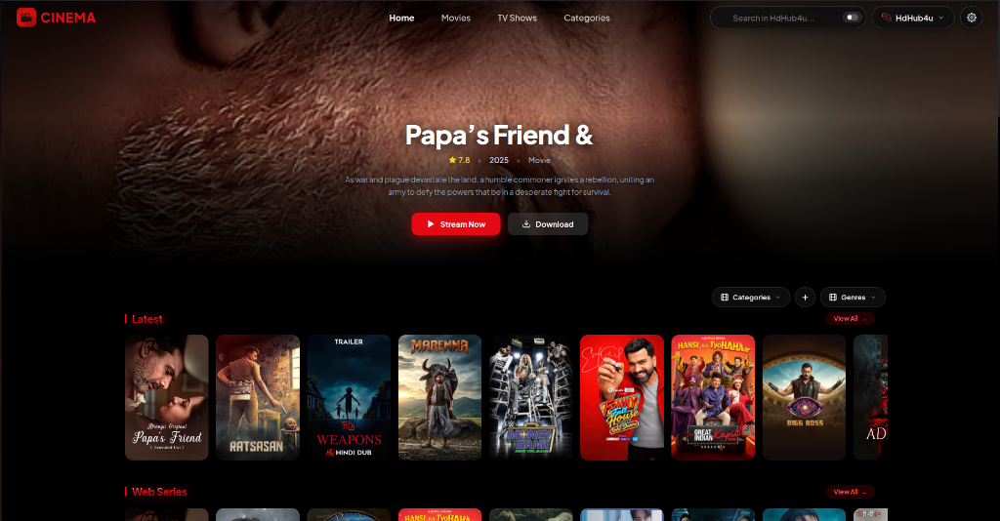

<div align="center">


<br/>

**Open-Source Media Streaming Client & Scraper Daemon Ecosystem**

A fast, client-side streaming application and provider indexing system for movies and series across Web, Android, Windows, Linux, and macOS.

<br/>

[](https://cinema-dwh.pages.dev/)
[](https://t.me/cinemaisherebtw_bot)
[](https://github.com/HarshSharma20050924/cinema/releases/latest)
[](https://github.com/HarshSharma20050924/cinema/releases/latest)
[](LICENSE)
[](CONTRIBUTING.md)

<br/>



</div>

---

## Table of Contents

- [Overview](#overview)
- [Ecosystem Components](#ecosystem-components)
- [Official Downloads](#official-downloads)
- [Telegram Bot Ecosystem](#telegram-bot-ecosystem)
- [Running in All Environments](#running-in-all-environments)
  - [1. Web Application](#1-web-application-browser)
  - [2. Local Backend Server](#2-local-backend-server)
  - [3. Desktop Application (Windows, Linux, macOS)](#3-desktop-application-electron)
  - [4. Desktop Runner Daemon](#4-desktop-runner-daemon)
  - [5. Android Mobile Application](#5-android-mobile-application)
  - [6. Android Runner Daemon](#6-android-runner-daemon)
  - [7. Telegram Bot Daemon](#7-telegram-bot-daemon)
  - [8. Docker Container](#8-docker-container)
  - [9. Cloudflare Pages Deployment](#9-cloudflare-pages-deployment)
- [Project Structure](#project-structure)
- [Contributing](#contributing)
- [Author & Contact Details](#author--contact-details)
- [Legal Disclaimer](#legal-disclaimer)
- [License](#license)

---

## Overview

Cinema provides a clean, ad-free streaming interface by separating the presentation layer from media resolvers. It indexes public streaming sources, parses HLS video manifests, and streams high-definition video directly to local players without popups, banners, or redirects.

Key features:
* **Multi-Platform Support**: Runs on Web browsers, Android phones, Android TV, Windows, Linux distros, and macOS.
* **Dual-Engine Architecture**: Main media player and background scraper helper work together seamlessly.
* **HLS Adaptive Playback**: Automatic resolution switching (480p to 4K), multi-language audio track selection, and subtitles.
* **External Player Forwarding**: Instant 1-click playback through external players like VLC, MPV, and MX Player.
* **Offline Download Manager**: Background multi-stream downloader with resume support.
* **Zero Telemetry**: No trackers, analytics SDKs, or session loggers.

---

## Ecosystem Components

Cinema is divided into two main products:

### 1. Cinema Application (Player & Catalog UI)
The primary client application for watching content.
* **Web**: React 19 single-page app running in modern browsers.
* **Desktop**: Electron wrapper for Windows 10/11, Linux (.deb & .AppImage), and macOS (Apple Silicon & Intel).
* **Android**: Native APK and lightweight Capacitor web app.

### 2. Cinema Runner (Background Scraper Daemon)
A background service that connects to provider sources, resolves links, and exposes a local scraping API for the client.
* **Android Runner**: Android foreground service running without root permissions.
* **Desktop Runner**: Headless background service for servers, Linux, Windows, and macOS.

### 3. Cinema Telegram Bot & Channel Ecosystem
An automated Telegram assistant and scheduled release channel powered by Cinema's scraping backend.
* **Interactive Bot**: Search movies/series, choose resolution & quality, stream via VLC, or download.
* **Release Channel Poster**: Automatically shares high-quality cards of new releases with direct interactive playback buttons.
* **Runner Bridge**: Connects directly to local or networked Cinema Runner instances to bypass datacenter IP restrictions.

---

## Official Downloads

All precompiled binaries and installation packages are published on the [GitHub Releases Page](https://github.com/HarshSharma20050924/cinema/releases/latest).

### Cinema Application (Player)

| Platform | Variant | Package Type | Direct Download |
| :--- | :--- | :--- | :--- |
| Android | Universal Native APK | `.apk` (~30 MB) | [Download Cinema.apk](https://github.com/HarshSharma20050924/cinema/releases/latest/download/Cinema.apk) |
| Android | Web Wrapper APK | `.apk` (~3.2 MB) | [Download Cinema-Web.apk](https://github.com/HarshSharma20050924/cinema/releases/latest/download/Cinema-Web.apk) |
| Windows | Setup Installer | `.exe` (~80 MB) | [Download Setup (.exe)](https://github.com/HarshSharma20050924/cinema/releases/latest) |
| Windows | Portable Executable | `.exe` (~80 MB) | [Download Portable (.exe)](https://github.com/HarshSharma20050924/cinema/releases/latest) |
| Linux | Ubuntu, Debian, Mint | `.deb` (~72 MB) | [Download Debian Package (.deb)](https://github.com/HarshSharma20050924/cinema/releases/latest) |
| Linux | All Distributions | `.AppImage` (~105 MB) | [Download Universal AppImage](https://github.com/HarshSharma20050924/cinema/releases/latest) |
| macOS | Apple Silicon & Intel | `.dmg` (~96 MB) | [Download Disk Image (.dmg)](https://github.com/HarshSharma20050924/cinema/releases/latest) |

### Cinema Runner (Background Daemon)

| Platform | Variant | Package Type | Direct Download |
| :--- | :--- | :--- | :--- |
| Android | Android Runner Service | `.apk` (~31 MB) | [Download Cinema-Runner.apk](https://github.com/HarshSharma20050924/cinema/releases/latest/download/Cinema-Runner.apk) |
| Windows | Runner Setup Installer | `.exe` (~80 MB) | [Download Runner Setup (.exe)](https://github.com/HarshSharma20050924/cinema/releases/latest) |
| Windows | Runner Portable | `.exe` (~80 MB) | [Download Runner Portable (.exe)](https://github.com/HarshSharma20050924/cinema/releases/latest) |
| Linux / Ubuntu / Debian | Runner Debian Package | `.deb` (~72 MB) | [Download Runner Debian (.deb)](https://github.com/HarshSharma20050924/cinema/releases/latest/download/cinema-node-runner_2.2.0_amd64.deb) |
| Linux / Server | Standalone Runner | `.AppImage` (~105 MB) | [Download Runner AppImage](https://github.com/HarshSharma20050924/cinema/releases/latest) |
| macOS | macOS Runner | `.dmg` (~96 MB) | [Download Runner Disk Image (.dmg)](https://github.com/HarshSharma20050924/cinema/releases/latest) |

---

## Telegram Bot Ecosystem

Cinema includes an interactive Telegram bot and automated release posting channel:

* **Official Bot**: [@cinemaisherebtw_bot](https://t.me/cinemaisherebtw_bot)
* **Official Channel**: [Join Updates Channel](https://t.me/+2QbDC2GcZFg0YjZl)
* **Runner Downloads**: [cinema-dwh.pages.dev/?tab=downloads](https://cinema-dwh.pages.dev/?tab=downloads)

### Features:
* **Instant Search & Filters**: Search across 38+ unified scrapers with multi-page pagination.
* **VLC Media Player Handoff**: 1-click launch to external VLC Player (Android, iOS, Windows, Mac, Linux) for zero-buffering hardware streaming.
* **Authentic Direct Downloads**: Filters out hotlink-protected streaming links that cause 429 rate-limit errors, providing genuine direct download mirrors (Cloudflare R2, Pixeldrain, Google Drive, FastDL).
* **Direct Extension Deep Links**: Clicking "Stream & Download" on a channel post opens that exact release directly from that provider without re-searching across other extensions.
* **Admin Controls**: Manage enabled providers in real-time (`/toggle <provider>`, `/providers`), trigger syncs (`/sync`), and pin guides (`/pinvlc`).
* **Cinema Runner Fallback**: Automatically connects to your local runner or active tunnel to bypass datacenter IP restrictions.

---

## Running in All Environments

### 1. Web Application (Browser)

Requires Node.js 22+ and npm 10+.

```bash
# Clone repository
git clone https://github.com/HarshSharma20050924/cinema.git
cd cinema

# Install dependencies
npm install

# Start development client (http://localhost:5174)
npm run dev

# Build production bundle (outputs to dist/)
npm run build

# Preview production build locally
npm run preview
```

### 2. Local Backend Server

The Node.js server handles provider scraping, stream resolution, and poster proxying.

```bash
cd cinema/server

# Install server dependencies
npm install

# Start local server on port 3000
node index.cjs
```

To run both client and server together with one command from the project root:
```bash
npm start
```

### 3. Desktop Application (Electron)

Desktop apps provide native window controls, hardware decoding, and automatic link routing.

```bash
cd cinema/desktop-app

# Install desktop dependencies
npm install

# Run desktop app in development mode
npm start

# Build installer packages
npm run dist:win      # Windows Setup (.exe) and Portable (.exe)
npm run dist:linux    # Linux Debian (.deb) and AppImage (.AppImage)
npm run dist:mac      # macOS Disk Image (.dmg)
```

Generated binaries will be located in `desktop-app/release/`.

### 4. Desktop Runner Daemon

The standalone runner executes provider scrapers as a background daemon.

```bash
cd cinema/desktop-runner

# Install dependencies
npm install

# Run runner in development mode
npm start

# Package standalone executables for all platforms
npm run dist:all
```

### 5. Android Mobile Application

Built using Capacitor and modern Android toolchains (Java 21, Android SDK 34+).

```bash
# 1. Build the web app
npm run build

# 2. Sync web assets to Capacitor
cd mobile-app
npm install
rm -rf dist && cp -r ../dist ./dist
npx cap sync android

# 3. Build release APK
cd android
chmod +x gradlew
./gradlew assembleRelease
```

The APK will be generated at `mobile-app/android/app/build/outputs/apk/release/app-release.apk`.

### 6. Android Runner Daemon

The Android Runner runs locally on your phone as a persistent background service.

```bash
# Sync runner web assets
mkdir -p android/app/src/main/assets/public
cp -r runner-app/public/* android/app/src/main/assets/public/

# Build runner APK
cd android
chmod +x gradlew
./gradlew assembleRelease
```

The output APK will be in `android/app/build/outputs/apk/release/app-release.apk`.

### 7. Telegram Bot Daemon

To run the interactive Telegram bot and automated release posting channel:

```bash
# 1. Install dependencies
cd telegram-bot
npm install

# 2. Configure credentials in telegram-bot/bot_settings.json or environment variables
# BOT_TOKEN, CHANNEL_ID, ADMIN_IDS

# 3. Start the bot and auto-poster daemon
node index.cjs
```

### 8. Docker Container

You can run Cinema inside a self-contained Docker container:

```bash
# Build Docker image
docker build -t cinema:latest .

# Run container on port 5174
docker run -d -p 5174:5174 --name cinema-app cinema:latest

# Check container logs
docker logs -f cinema-app
```

Access the application in your browser at `http://localhost:5174`.

### 9. Cloudflare Pages Deployment

Cinema deploys directly to Cloudflare Pages as a high-performance static web application with serverless functions:

```bash
# 1. Build production bundle
npm run build

# 2. Deploy dist/ to Cloudflare Pages via Wrangler
npx wrangler pages deploy dist --project-name=cinema --branch=production
```

Or push changes to the `main` branch to trigger the automated Cloudflare GitHub integration.

---

## Project Structure

```
cinema/
├── src/                    # React 19 client application
│   ├── components/         # UI components (catalog, media, hero, layout, download)
│   ├── hooks/              # Custom React hooks (useCatalog, useProviders, useSettings)
│   ├── api/                # API client and TMDB integration
│   └── utils/              # Cache and navigation state helpers
├── server/                 # Express backend provider engine
│   ├── controllers/        # Media and stream controllers
│   ├── providers/          # Community provider scrapers
│   └── routes/             # API routes
├── telegram-bot/           # Telegram Bot & Channel Ecosystem
│   ├── bot.cjs             # Interactive Telegram bot with VLC handoff & pagination
│   ├── autoPoster.cjs      # Scheduled channel release card poster
│   ├── cinemaApi.cjs       # Scraper engine bridge with dynamic runner discovery
│   ├── linkStore.cjs       # Shared persistent link cache
│   └── config.cjs          # Ecosystem configuration & provider settings
├── desktop-app/            # Electron desktop application (Windows, Linux, macOS)
├── desktop-runner/         # Standalone desktop scraper daemon
├── mobile-app/             # Capacitor mobile wrapper
├── runner-app/             # Android background runner UI
├── android/                # Native Android gradle project
├── public/                 # Static assets, logos, and icons
├── functions/              # Cloudflare Pages serverless functions
├── .github/workflows/      # GitHub Actions CI/CD workflows
│   ├── build-desktop-app.yml     # Desktop builds
│   ├── build-desktop-runner.yml  # Runner builds
│   └── build-mobile-apps.yml     # Android APK builds
├── wrangler.toml           # Cloudflare Pages configuration
└── CONTRIBUTING.md         # Contribution guidelines
```

---

## Contributing

Contributions, bug reports, and provider additions are appreciated. Please read the [Contributing Guidelines](CONTRIBUTING.md) before submitting pull requests.

---

## Author & Contact Details

* **Author**: Harsh Sharma
* **Email**: [harsh20050924@gmail.com](mailto:harsh20050924@gmail.com)
* **GitHub**: [github.com/HarshSharma20050924](https://github.com/HarshSharma20050924)
* **Instagram**: [instagram.com/harshsharma200509](https://www.instagram.com/harshsharma200509/)
* **Live Web App**: [cinema-dwh.pages.dev](https://cinema-dwh.pages.dev/)

---

## Legal Disclaimer

Cinema is a client-side media indexer and player. It does not host, upload, store, or broadcast any video or media content on its own servers. All media information and stream references are retrieved from community scrapers. Users are responsible for complying with all applicable local copyright laws.

For details, view our [Terms of Service](https://cinema-dwh.pages.dev/?tab=terms) and [DMCA Policy](https://cinema-dwh.pages.dev/?tab=disclaimer).

---

## License

This project is licensed under the Apache License 2.0. See the [LICENSE](LICENSE) file for details.
